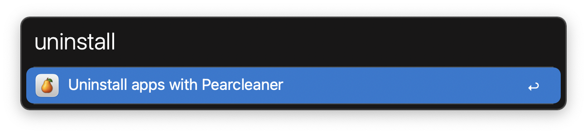
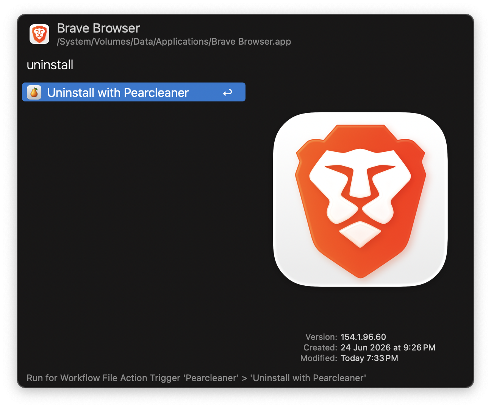

#  Pearcleaner Alfred Workflow

Uninstall apps with [Pearcleaner](https://pearcleaner.com)

[⤓ Download the workflow](https://github.com/iAli/pearcleaner-workflow/releases/latest)

## Usage

Search and uninstall apps via the `uninstall` keyword.

Alternatively, uninstall an app via the Universal Action.

